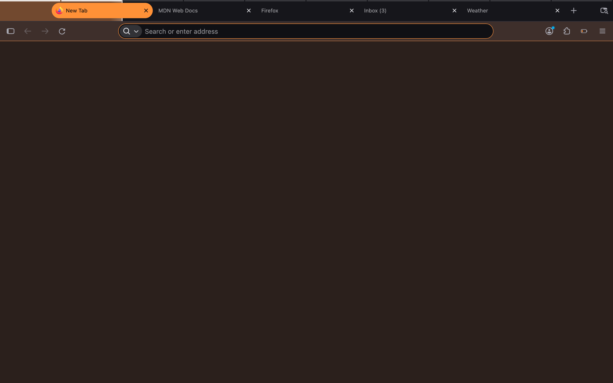

# Battery Theme

A Firefox theme that reflects your laptop's battery. The tab strip fills up to your charge level like a gauge, with a thin ten-cell meter line along the top edge of the window, and its colour shifts from green through amber to red as the battery drains, spreading to the active tab and toolbar when it gets low. While charging it turns blue.



Firefox can't read the battery on its own, so there are two parts:

- **The extension** (`extension/`) recolours Firefox and provides the toolbar button and popup.
- **The helper** (`host/`) is a small shell script that Firefox starts in the background. It reads the battery from the operating system and hands it to the extension. It makes no network connections and the extension collects no data.

| System | Status |
| --- | --- |
| macOS | Tested on macOS with Firefox 140 ESR, 160 and 161. Reacts to the charger within about a second. |
| Linux | The helper has been run under real Linux Firefox (153 ESR and 160, in Docker) against a simulated battery, but not yet on a real Linux laptop. Checks the battery every 5 seconds. |
| Linux, Flatpak Firefox | Works: the installer puts a second copy of the helper where a Flatpak Firefox looks. Tested with Flathub's Firefox 160. |
| Linux, Snap Firefox | Untested. A Snap Firefox asks the desktop to start the helper and may show an "Allow" dialog the first time; this needs Ubuntu's desktop portal. |
| Windows | Experimental: the helper's logic is tested, but it has never been run on a real Windows machine. Checks the battery every 5 seconds. |

Needs Firefox 140 or later. Right-to-left Firefox (Arabic, Hebrew, Persian…) gets a mirrored gauge. Vertical tabs are supported: the gauge sits in the top bar.

## Install

### 1. The helper (macOS and Linux)

```bash
curl -fsSL https://raw.githubusercontent.com/william-ricchiuti/battery-theme/main/install.sh | bash
```

That downloads two small scripts for your system and installs them for your user only; no `sudo`. If you'd rather read the code first, download or clone this repository and run `bash install.sh` inside it.

On Windows, download the project and run `host\windows\install.bat` (and `host\windows\uninstall.bat` to remove it).

### 2. The extension

Until the addons.mozilla.org listing is live, load it by hand: open `about:debugging#/runtime/this-firefox`, choose **Load Temporary Add-on**, and pick `extension/manifest.json`. A temporary add-on is removed whenever Firefox restarts.

## Using it

Click the battery button in the toolbar to see the percentage, time remaining and these settings:

| Setting | What it does |
| --- | --- |
| Colours | **Green to red**, or **Colour-blind safe** (neutral to orange). Charging is blue in both. |
| Appearance | Follow the system's light/dark mode, or force one. Following the system works on every OS and switches as soon as the system does (on Firefox 140 ESR, within a minute). |
| Tint strength | How strongly the battery colour tints the browser. |
| Style | **Vivid** shows the battery colour at every level: a coloured gauge, a solid battery-coloured active tab and a coloured line under the toolbar. **Quiet until low** stays close to neutral while the battery is healthy. |
| Fill the tab strip to the battery level | The gauge: the strip fills to your charge level with a bright leading edge, and a thin ten-cell meter line runs along the top edge, where it stays visible even when the fill is short. Turn off for an even tint across the whole strip. |
| Flash when the battery drops to 20% and 10% | A one-second brighter flash of the tab strip and toolbar. Also off when the system's "reduce motion" setting is on. |
| Show percentage on the toolbar button | Adds the number as a badge on the button. |
| Tint Firefox with the battery colour | Turn off to pause the tint. The button and popup keep showing the battery. |

While the tint is on, Battery Theme takes over the browser theme and repaints if another theme is applied. Pause it (or disable the add-on) to use a different theme.

If the button shows **?**, the helper isn't connected or isn't answering: the add-on opens a setup page the first time, and the popup has the install command and a **Try again** button. If it shows **-**, the computer has no battery and the theme stays out of the way (a desktop on a UPS counts as no battery on macOS and Linux).

If you can't tell blue from green (tritanopia), pick **Colour-blind safe**: in the default palette "charging" and "healthy" look alike to you.

To see every colour state without waiting for your battery to drain, open `preview.html` in a browser.

## Optional: outlined tabs (macOS and Linux)

Firefox themes can only set colours, so the extension can't outline inactive tabs. This optional stylesheet does:

```bash
bash userChrome/install-userchrome.sh
```

Then set `toolkit.legacyUserProfileCustomizations.stylesheets` to `true` in `about:config` and restart Firefox. The installer never overwrites an existing `userChrome.css`; it backs it up and adds one `@import` line. If you have more than one Firefox installed (say Firefox and Developer Edition) it asks which; `--all` does every one. Details are in `userChrome/README.md`.

## Uninstall

```bash
curl -fsSL https://raw.githubusercontent.com/william-ricchiuti/battery-theme/main/install.sh | bash -s -- --uninstall
```

(or `bash install.sh --uninstall` from a copy of the project)

```bash
bash userChrome/install-userchrome.sh --uninstall
```

Remove the extension itself from `about:addons`.

## Development

```bash
npm test             # unit tests: helpers, colour model, installers, package checks
npm run test:e2e     # end-to-end tests in a real Firefox (FIREFOX_BIN picks the build)
npm run check        # unit tests + web-ext lint + store zip check
npm run check:all    # all of the above + shellcheck
npm run test:linux   # unit and end-to-end tests on Linux, in Docker
npm run build        # zip in web-ext-artifacts/
npm start            # run in a scratch Firefox profile
```

- The end-to-end tests start Firefox on a throwaway profile and home folder, so they never touch your own profile or your installed helper. They read the colours Firefox actually applied and the pixels it actually drew.
- `extension/gauge/` holds the generated gauge images; `npm run gauge` rebuilds them (a test fails if they are stale).
- `extension/theme-colors.js` is the whole colour model: pure functions, with tests that check text and icon contrast at every battery level, a colour snapshot, and a colour-blind simulation.
- `extension/background.js` talks to the helper and applies the theme.
- `host/mac/battery-host.sh --json` (or `host/linux/...`, or `battery-host.ps1 -Json` on Windows) prints the state the helper would send.
- `node tools/shoot.js <folder>` takes screenshots of a real Firefox window in every battery state.
- `HANDOFF.md` has the design notes, the message format, the Firefox constraints behind the design, and what has been tested where.
- `docs/amo-listing.md` has the store listing text and the notes for Mozilla's reviewers.
- `docs/ci/github-actions.yml` is a proposed CI workflow. It is not active until copied to `.github/workflows/`.

To get a signed build that survives restarts without the store listing, set `WEB_EXT_API_KEY` and `WEB_EXT_API_SECRET` from your [Firefox Add-ons API keys](https://addons.mozilla.org/developers/addon/api/key/) and run `npm run sign`.

## Licence

MIT. See `LICENSE`.
